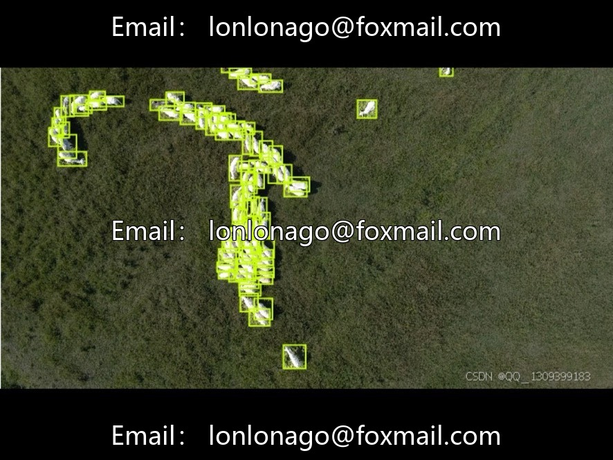
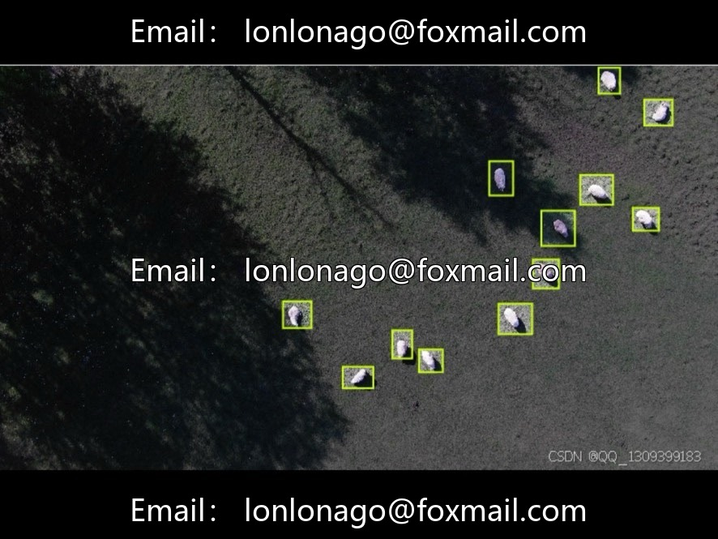
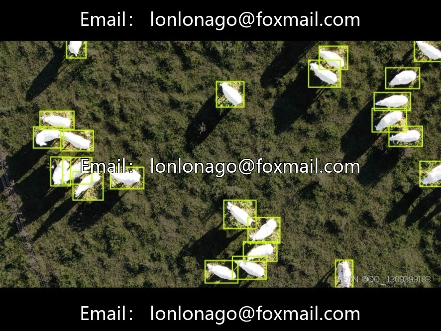
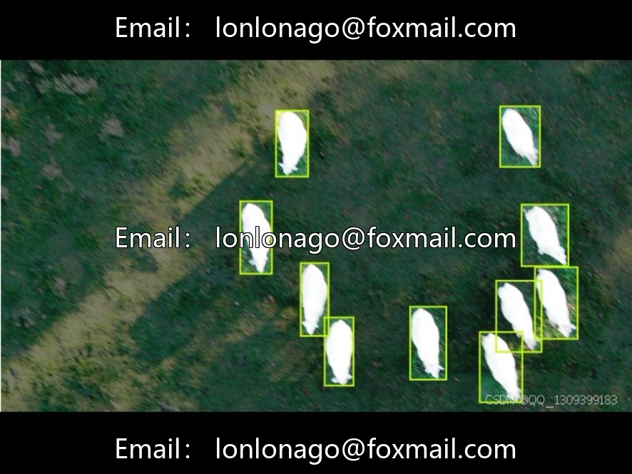

# Drone aerial photography sheep count dataset, issue 10006 Aerial She

## Body

Drone aerial sheep count dataset, 10006th issue - Aerial Sheep Grassland Farm Sheep Counting Dataset. This dataset is specifically designed for drone-view sheep detection and counting tasks, suitable for training deep learning models.

The dataset contains 1727 aerial images, with sheep (sheep) as the single category. It does not differentiate between breeds, ages, or genders, thus reducing the difficulty of annotation and enhancing efficiency. The sheep density is diverse, covering real pastoral scenes, which results in good model training effects, with mAP@50 reaching 96.8% and a recall rate of 96.9%.

Single-category setting, suitable for scenarios such as herd statistics in pastures, group monitoring, and drone livestock inspection. However, it lacks detailed annotations, unable to support tasks like breed differentiation and age recognition. It requires secondary annotation for expansion.

Virtual materials, once sold, are non-refundable.
Interested friends, click "I want" to proceed.

## Images

## Payment

Here is a pay link on Stripe ( https://buy.stripe.com/3cs8yP7sY87d0vu9AB ). Please contact me lonlonago@foxmail.com after funding $89, and I will send you a complete data files , thank you!

